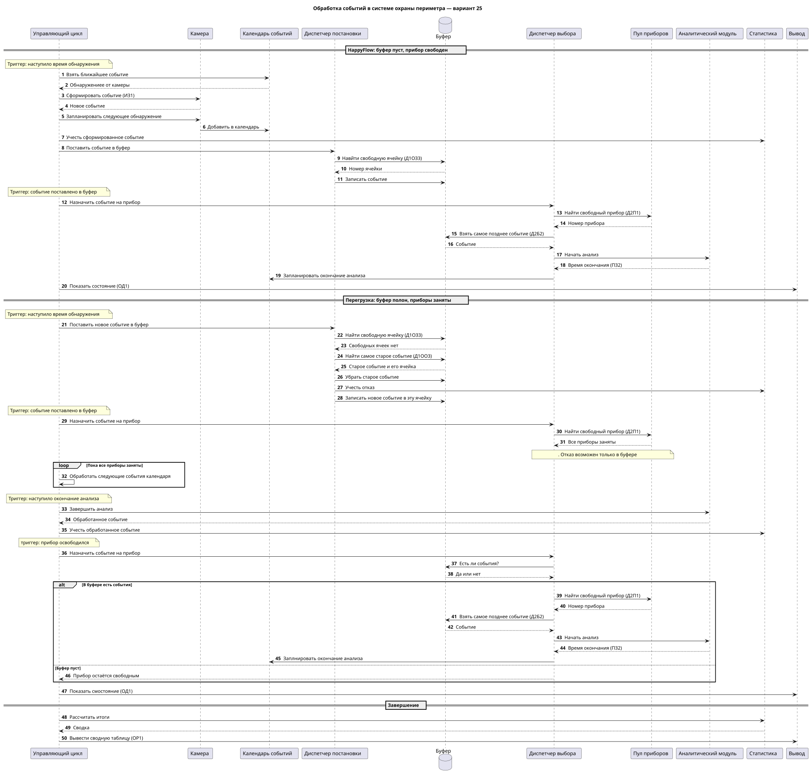
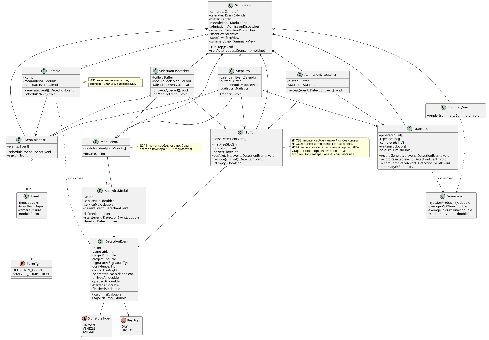
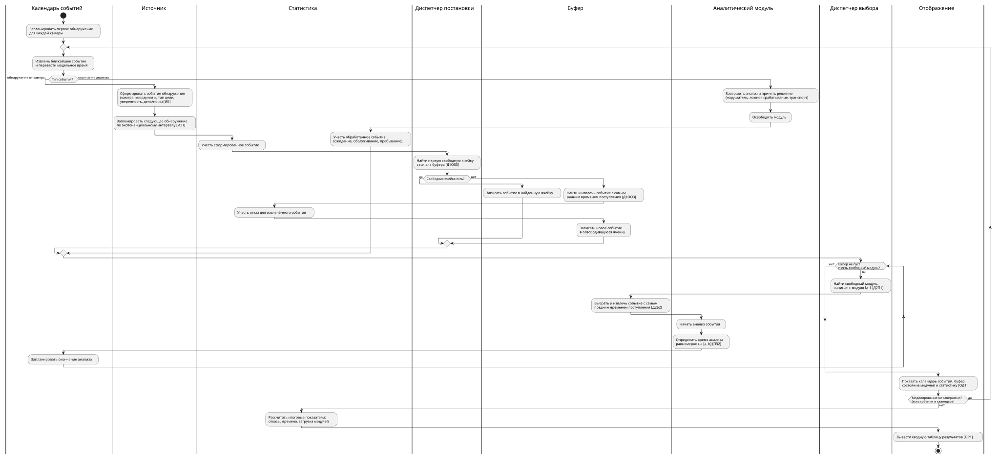

# Охрана периметра с тепловизионными камерами, вариант 25

Имитационная модель информационной системы охраны периметра предприятия. Камеры с тепловизорами формируют события обнаружения, события ждут в ограниченном буфере, а аналитические модули центрального узла их обрабатывают. При перегрузке система сохраняет свежие данные: отбрасывается самое старое событие.

`ИБ | ИЗ1 | ПЗ2 | Д1ОЗ3 | Д1ОО3 | Д2П1 | Д2Б2 | ОР1 | ОД1`

## Соответствие элементов

| Элемент СМО | Сущность домена |
| --- | --- |
| Источник | Камера с тепловизором на периметре |
| Заявка | Событие обнаружения: камера, время, координаты цели, тип сигнатуры, уверенность, день/ночь, признак пересечения периметра |
| Буфер | Ограниченная очередь событий с отдельными ячейками |
| Прибор | Аналитический модуль центрального узла |
| Диспетчер постановки | Приём нового события и размещение его в буфере |
| Диспетчер выбора | Планировщик: выбирает событие из буфера и свободный модуль |
| Отказ | Отбрасывание самого старого события из полного буфера |
| Календарь событий | Моменты следующих обнаружений и окончаний анализа |
| Статистика | Счётчики событий, отказов, времена ожидания, обслуживания и пребывания, загрузка модулей |

## Расшифровка варианта

| Код | Правило |
| --- | --- |
| **ИБ** | Камеры создают события без ограничения их общего числа |
| **ИЗ1** | Поток пуассоновский: интервалы между событиями распределены экспоненциально |
| **ПЗ2** | Время анализа события распределено равномерно |
| **Д1ОЗ3** | Событие занимает первую свободную ячейку с начала буфера, остальные не сдвигаются |
| **Д1ОО3** | Если буфер полон и все модули заняты, отбрасывается самое старое событие в буфере, новое занимает его ячейку |
| **Д2Б2** | Из буфера на анализ берётся событие, поступившее последним (LIFO) |
| **Д2П1** | Свободный модуль ищется с модуля № 1, выбирается первый найденный |
| **ОР1** | Автоматический режим выводит сводную таблицу результатов |
| **ОД1** | Пошаговый режим показывает календарь событий, буфер и текущее состояние системы |

## Диаграмма последовательности

Диаграмма разбита на три сценария, перед ними дана расшифровка кода варианта. Каждое действие диспетчеров запускается триггерным событием календаря: поступлением обнаружения, постановкой события в буфер или освобождением прибора.

1. **HappyFlow:** буфер пуст, прибор свободен. Событие ставится в первую свободную ячейку и сразу уходит на прибор по LIFO.
2. **Перегрузка:** буфер полон и все приборы заняты. Самое старое событие вытесняется и учитывается как отказ, новое занимает его ячейку, затем идёт цикл ожидания. После освобождения прибора из буфера берётся самое позднее событие и ставится на обработку.
3. **Завершение моделирования:** итоговая сводная таблица (ОР1).

[код puml](diagrams/sequence.puml) · [SVG](out/sequence.svg)

## Диаграмма классов

| Класс | Назначение |
| --- | --- |
| `Simulation` | Управляет шагами и автоматическим запуском модели |
| `Camera` | Источник: формирует события и планирует следующее обнаружение |
| `DetectionEvent` | Заявка: данные обнаружения, временные метки и статус |
| `EventCalendar`, `Event` | Хранят запланированные события модели |
| `Buffer` | Ячейки с ожидающими событиями, поиск свободной, самой старой и самой поздней |
| `AdmissionDispatcher` | Ставит событие в буфер и вытесняет самое старое при переполнении |
| `SelectionDispatcher` | Назначает события свободным модулям при поступлении и освобождении |
| `ModulePool`, `AnalyticsModule` | Аналитические модули и поиск свободного с модуля № 1 |
| `Statistics`, `Summary` | Собирают показатели по камерам и формируют итоговую сводку |
| `StepView`, `SummaryView` | Пошаговый вывод (ОД1) и сводная таблица (ОР1) |

[код puml](diagrams/class.puml) · [SVG ](out/class.svg)

## Блок-схема с дорожками

Дорожки соответствуют участникам: календарь событий, источник, диспетчер постановки, буфер, диспетчер выбора, аналитический модуль, статистика и отображение. Схема построена по принципу особых событий: поступление события, окончание анализа, повторный выбор из буфера, показ шага и итоговая сводка.

[код puml](diagrams/flowchart.puml) · [SVG](out/flowchart.svg)

